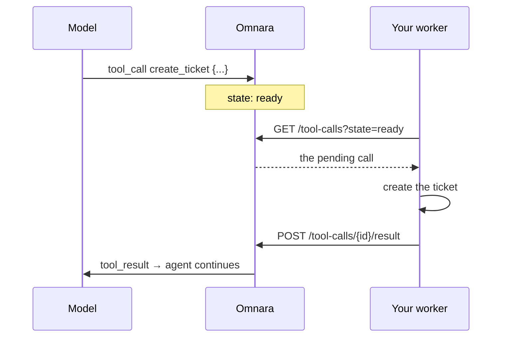

A custom tool is how an agent reaches systems only you can touch — your ticket tracker, your database, your deploy pipeline. The division of labor is clean: **you describe the tool, the model decides when to call it, and your code does the work**. Omnara sits in the middle holding the call durably until you answer it.



Because the call is a durable event, your worker can crash, redeploy, or take minutes to respond — the agent simply waits, and nothing is lost.

Running the tool in your own system also means:

- **Any language.** Your worker is any code that can make HTTPS requests, and it can share types, database access, and tests with the rest of your backend.
- **No inbound access.** A worker that polls for ready calls only makes outbound requests, so your database and internal services never have to be reachable from Omnara.
- **Separate deploys.** You ship and scale tool code on your own schedule, and running agents aren't affected.
- **One result per call.** Omnara accepts the first result submitted for a call and rejects later ones, so a retried worker can't complete a call twice.

## Declare the tool

In the agent config, a custom tool is a name, a description, and a JSON Schema for its input. Write the description as clear instructions: explain when to use the tool, what it does, and any important limits.

```yaml
tools:
  create_ticket:
    type: custom
    description: >-
      File a ticket in the internal tracker. Use for actionable engineering
      work discovered during the conversation; keep titles under 80 chars.
    input_schema:
      type: object
      properties:
        title: { type: string }
        body: { type: string }
        priority: { type: string, enum: [low, normal, urgent] }
      required: [title]
```

Custom tools default to `always_allow`; set `permission.mode: always_ask` to put a human between the model and your system ([Tools & permissions](/tools/permissions)).

## Find calls waiting for you

`GET /tool-calls` lists an agent's tool calls, filterable by `state` and `type`. Your worker polls for ready custom calls:

```bash
curl "$OMNARA_API/orgs/$ORG/projects/$PROJ/agents/$AGENT/tool-calls?state=ready&type=custom" \
  -H "Authorization: Bearer $OMNARA_TOKEN"
```

```json
{
  "data": [
    {
      "id": "tcl_wz3jehcyd5n6a2bfgik7mv4qtr",
      "turn_id": "trn_trwz3jehcyd5n6a2bfgik7mv4q",
      "provider_call_id": "call_9f3k",
      "name": "create_ticket",
      "input": { "title": "Flaky retry logic in payments worker", "priority": "normal" },
      "type": "custom",
      "state": "ready",
      "created_at": "2026-08-03T20:15:09Z"
    }
  ],
  "next_cursor": null
}
```

`ready` means the permission check has passed and the call is waiting for your result. A custom call using `always_ask` remains in `awaiting_permission` until someone responds to its [interaction](/events/interactions). After you submit a result, it moves to `completed`.

To find ready custom calls from every agent in the project, including subagents, query `GET $OMNARA_API/orgs/$ORG/projects/$PROJ/tool-calls?state=ready&type=custom`. Each call includes its `agent_id`; use it when you submit the result. If you run custom tools from webhooks, use this list as the backstop: deliveries stop retrying after 10 minutes, so a periodic call picks up any ready call whose delivery was missed.

<Tip>
To avoid continuous polling, which counts against your [rate limits](/api/overview#rate-limits), connect to the agent's [event stream](/events/streaming), then query `GET /tool-calls?state=ready&type=custom` for already-ready calls and watch for future `tool_call_update` frames whose `state` is `ready`. Repeat the query after reconnecting because lifecycle updates are not replayed. Subagents can call custom tools too: the parent's stream carries their `tool_call_update` frames with the subagent's `agent_id`, and `include_subagents=true` on the query returns their calls.

You can also configure an [Event webhook](/agents/configuration#event-webhooks) to trigger custom-tool execution when a `tool_call_update` arrives with `state: ready`. On the stream and in webhooks, `ready` updates for custom calls include the tool's `name`, plus its `input` when the JSON-encoded input is at most 64 KiB; for larger inputs, fetch the call with `GET /tool-calls/{toolCallID}`. See the runnable [custom-tool webhook example](https://github.com/omnara-ai/omnara/tree/main/examples/custom-tool-webhook) for signature verification and duplicate handling.
</Tip>

## TypeScript helper

The SDK's `createCustomToolWorker` connects tool functions to this workflow.
Choose a project, optionally an agent profile, and register the functions you
handle. The helper uses inputs supplied by authenticated events and list pages,
fetching a call only when its input was omitted. It submits results, retries
temporary API failures, and retains finished results in memory when submission
fails. Its optional `run()` loop starts recovery immediately and repeats while
running. Large scans continue across passes so older deferred jobs cannot hide
newer calls.

Use `handle(update)` inside a queue job, or `check()` in a scheduled task.
`check()` processes one page and returns `nextCursor`; follow that cursor to
finish the pass. For time-limited jobs, save the cursor after each completed
page and resume it on the next invocation; restart from the beginning only
after reaching the end. Both methods accept a per-operation `signal`, for example
`AbortSignal.timeout(25_000)`, without shutting down the helper. API requests
make at most three attempts within a 30-second budget, honoring `Retry-After`.
Use `requestTimeoutMs` to allow more time for large result uploads.
A retry that cannot fit in the budget returns an error instead of waiting or
retrying early. Tool functions receive cancellation through their `signal` and
must cooperate with it; JavaScript cannot forcibly stop a running function.

Tools that finish later can return `{ outcome: 'deferred' }`. This submits no
result and releases the execution slot. A later event or recovery check invokes
the function again, so it can check the application's durable job and return its
saved result when ready. Start that job idempotently using the tool-call ID.
Enable `run()` or schedule `check()` to revisit deferred calls; webhook handling
alone does not poll them. The application can also submit the result directly
when its job completes. It owns cancellation of jobs after their handlers return.

Unexpected handler errors produce a generic failed tool result; the original
error goes only to `onError`. Return an explicit failed result when you intend
the model to see a particular explanation. `onError` receives the call when one
is involved, or `undefined` for a recovery-listing failure. `run()` reports
listing failures and keeps checking on later passes until shut down.

Webhooks and SSE include the emitting agent's organization, project, agent ID,
and nullable profile ID, plus its parent and root agent IDs. The parent is
`null` for a top-level agent; the root is that agent itself. The SDK filters on
organization, project, and profile without fetching the agent. Pass webhook
bodies through `verifyEventWebhook` before using their contents. Configure a
signing secret and keep it out of agent machines and tool inputs: it authorizes
requests to your tool handlers.

Events can arrive late or more than once. The helper joins concurrent attempts
for the same call and remembers the most recent 1,000 completed or permanently
rejected call IDs. This is a bounded local optimization, not an execution
guarantee across instances or restarts. A `completed` event signals an active
handler to stop; cancellation
cannot undo work already performed. Use the tool-call ID as an idempotency key
when a tool changes external state.

See the [complete example](https://github.com/omnara-ai/omnara/tree/main/examples/custom-tool-webhook)
for webhook verification, deferred jobs, pagination, deadlines, and shutdown.

## Submit the result

Post the outcome with content blocks — text, inline media, or structured data:

```bash
curl "$OMNARA_API/orgs/$ORG/projects/$PROJ/agents/$AGENT/tool-calls/tcl_wz3jehcyd5n6a2bfgik7mv4qtr/result" \
  -H "Authorization: Bearer $OMNARA_TOKEN" \
  -H "Content-Type: application/json" \
  -d '{
    "outcome": "succeeded",
    "content_blocks": [
      { "type": "structured_data", "value": { "ticket_id": "ENG-4212", "url": "https://tracker.acme.dev/ENG-4212" } }
    ]
  }'
```

`201` returns both the completed call and the durable `tool_result` event now in the agent's timeline:

```json
{
  "tool_call": {
    "id": "tcl_wz3jehcyd5n6a2bfgik7mv4qtr",
    "name": "create_ticket",
    "type": "custom",
    "state": "completed",
    "outcome": "succeeded",
    "completed_at": "2026-08-03T20:15:31Z",
    "...": "..."
  },
  "tool_result": {
    "event_id": "evt_5n6a2bfgik7mv4qtrwz3jehcyd",
    "agent_id": "agt_v4qtrwz3jehcyd5n6a2bfgik7m",
    "tool_call_id": "tcl_wz3jehcyd5n6a2bfgik7mv4qtr",
    "outcome": "succeeded",
    "content_blocks": [ { "type": "structured_data", "value": { "ticket_id": "ENG-4212", "...": "..." } } ],
    "created_at": "2026-08-03T20:15:31Z"
  }
}
```

The agent wakes and continues its turn with your result in context. If your system failed, submit `outcome: "failed"` with a text block explaining why — a failed tool call is information the model can act on, not an error you should swallow.

Result text, structured-data string keys and values, and metadata must not contain U+0000.

**The first result wins.** Only `ready` custom calls accept results. Submitting to a call that has already finished returns `409` with code `tool_call_already_completed`, including when the call was canceled:

```json
{ "error": "custom tool call is already completed", "code": "tool_call_already_completed" }
```

A result for a call that isn't ready, or for a built-in or MCP call, returns `409` with code `conflict`.

That makes result submission safe when several workers race for the same call: the losers get a clean `409`, not a corrupted timeline. The specific `tool_call_already_completed` code means no further submission is needed. It does not establish whose result was accepted or whether the call was canceled.

<Info>
Full schema and playground: [List tool calls](/api-reference/endpoints/agents/list-tool-calls) · [Get a tool call](/api-reference/endpoints/agents/get-a-tool-call) · [List unfinished tool calls across agents](/api-reference/endpoints/agents/list-unfinished-tool-calls-across-agents) · [Submit a result](/api-reference/endpoints/agents/submit-a-result-for-a-ready-custom-tool-call).
</Info>
