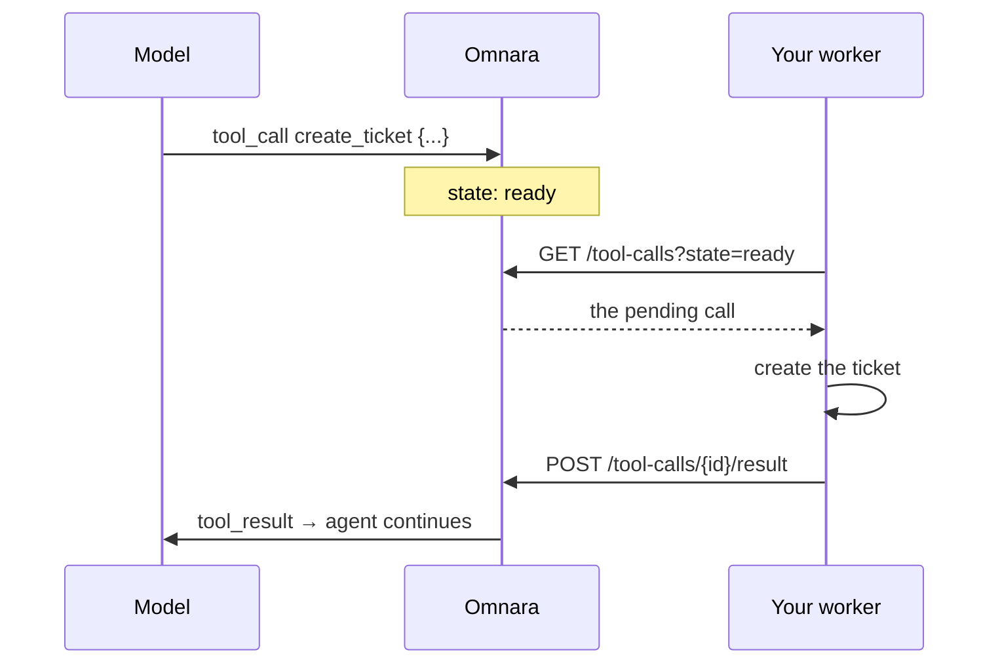

A custom tool is how an agent reaches systems only you can touch — your ticket tracker, your database, your deploy pipeline. The division of labor is clean: **you describe the tool, the model decides when to call it, and your code does the work**. Omnara sits in the middle holding the call durably until you answer it.



Omnara keeps the ready call until it is answered or canceled. Your application owns any external work or computed result that must survive a crash or redeploy.

Running the tool in your own system also means:

- **Any language.** Your worker is any code that can make HTTPS requests, and it can share types, database access, and tests with the rest of your backend.
- **No inbound access.** A worker that polls for ready calls only makes outbound requests, so your database and internal services never have to be reachable from Omnara.
- **Separate deploys.** You ship and scale tool code on your own schedule, and running agents aren't affected.
- **One result per call.** Omnara accepts the first result submitted for a call and rejects later ones, so a retried worker can't complete a call twice.

## Declare the tool

In the agent config, a custom tool is a name, a description, and a JSON Schema for its input. Write the description as clear instructions: explain when to use the tool, what it does, and any important limits.

```yaml
tools:
  create_ticket:
    type: custom
    description: >-
      File a ticket in the internal tracker. Use for actionable engineering
      work discovered during the conversation; keep titles under 80 chars.
    input_schema:
      type: object
      properties:
        title: { type: string }
        body: { type: string }
        priority: { type: string, enum: [low, normal, urgent] }
      required: [title]
```

In the dashboard, choose **Tools → + → Custom tool**. Enter a name and edit the starter definition in the config's YAML or JSON format. Custom tools appear alongside other tools with a **Custom** label. Click a row to edit its full definition; its permission and remove controls work like those of other tools.

`input_schema` is a JSON Schema object even when written using YAML syntax. Omnara validates the schema when compiling the config, using the same validator that checks tool-call inputs. The root must be an object schema, and every root `required` field must appear in `properties`. Remote references and regex features unsupported by RE2 are rejected with a schema-path error.

Custom tools default to `always_allow`; set `permission.mode: always_ask` to put a human between the model and your system ([Tools & permissions](/tools/permissions)).

## Find calls waiting for you

`GET /tool-calls` lists an agent's tool calls, filterable by `state` and `type`. Your worker polls for ready custom calls:

```bash
curl "$OMNARA_API/orgs/$ORG/projects/$PROJ/agents/$AGENT/tool-calls?state=ready&type=custom" \
  -H "Authorization: Bearer $OMNARA_TOKEN"
```

```json
{
  "data": [
    {
      "id": "tcl_wz3jehcyd5n6a2bfgik7mv4qtr",
      "turn_id": "trn_trwz3jehcyd5n6a2bfgik7mv4q",
      "provider_call_id": "call_9f3k",
      "name": "create_ticket",
      "input": { "title": "Flaky retry logic in payments worker", "priority": "normal" },
      "type": "custom",
      "state": "ready",
      "created_at": "2026-08-03T20:15:09Z"
    }
  ],
  "next_cursor": null
}
```

`ready` means the permission check has passed and the call is waiting for your result. A custom call using `always_ask` remains in `awaiting_permission` until someone responds to its [interaction](/events/interactions). After you submit a result, it moves to `completed`.

To find ready custom calls from every agent in the project, including subagents, query `GET $OMNARA_API/orgs/$ORG/projects/$PROJ/tool-calls?state=ready&type=custom`. Each call includes its `agent_id`; use it when submitting the result. The project endpoint also accepts `agent_profile_id` and repeated `names` filters.

[Webhooks](/events/webhooks) and [SSE](/events/streaming) deliver `tool_call_update` notifications promptly. Connect, check for already-ready calls, and handle incoming updates. Keep periodically checking while connected too: webhook retries end after ten minutes, and SSE lifecycle updates can be dropped without a disconnect and are not replayed.

For a single agent tree, use the agent-scoped `GET /agents/{agentID}/tool-calls?state=ready&type=custom&include_subagents=true`. A parent's stream includes its descendants' tool updates, so the recovery query must include those descendants too. The project endpoint above already includes all agents and subagents in its scope.

Ready custom-call notifications include `name` and, for inputs up to 64 KiB, `input`. Fetch a call directly with `GET /agents/{agentID}/tool-calls/{toolCallID}` when needed. Notifications can arrive late; read current readiness before starting work.

## TypeScript helper

`createCustomToolWorker` provides two finite operations. `handle(update)` checks the event's organization, project and optional profile, reads the call's current state and input, invokes its registered function, and submits the result. `check({ cursor, limit })` reads one page of ready calls with their full inputs and starts handling them directly, without a GET for each call. Both use the client's HTTP retries; neither schedules future work or retains failed deliveries.

```typescript
import { createCustomToolWorker, createOmnaraClient } from '@omnara/sdk'

const client = createOmnaraClient({ auth, timeoutMs: 30_000 })
const worker = createCustomToolWorker({
  client,
  path: { orgID, projectID },
  tools: {
    create_ticket: async ({ toolCallID, input, signal }) => {
      // The application makes this external action safe to repeat across processes.
      const ticket = await tickets.createOnce(toolCallID, input, { signal })
      return {
        outcome: 'succeeded',
        content_blocks: [{ type: 'structured_data', value: ticket }],
      }
    },
  },
})
```

Pass only authenticated SSE frames or signature-verified webhook updates to `handle`. Verify webhook bodies with `verifyEventWebhook` before using their contents. A signing secret authorizes requests to your tool handlers; keep it out of agent machines and tool inputs.

### Recover a result without repeating the action

The client's [request policy](https://github.com/omnara-ai/omnara/tree/main/frontend/packages/sdk#retries-and-deadlines) retries a result POST without calling the tool function again. Set `timeoutMs` or pass an operation `signal` to bound a stalled request. If delivery still fails, `handle` rejects with `CustomToolDeliveryError`.

Its `result` is a detached JSON snapshot ready for resubmission. Its `call`, `cause`, and optional `retryAt` identify the call, underlying failure, and server's earliest retry time in epoch milliseconds.

```typescript
import { CustomToolDeliveryError, sdk } from '@omnara/sdk'

try {
  await worker.handle(update, { signal })
} catch (error) {
  if (!(error instanceof CustomToolDeliveryError)) throw error
  // Your job/storage layer keeps this result and schedules delivery at or after retryAt.
  await deliveries.save({ call: error.call, result: error.result, retryAt: error.retryAt })
}

// In the application's delivery job, submit the saved result, not the business action.
await sdk.submitToolCallResult({
  client,
  path: { orgID, projectID, agentID: saved.call.agentID, toolCallID: saved.call.toolCallID },
  body: saved.result,
})
```

Here `deliveries` is application-owned storage. A repeatable calculation can instead be recomputed on the next check, as the [runnable webhook example](https://github.com/omnara-ai/omnara/tree/main/examples/custom-tool-webhook) does. Consequential actions need duplicate protection and any persistence required across restarts.

The helper treats `409 tool_call_already_completed` as `completed`; direct delivery jobs must handle it too. See [result submission](#submit-the-result) for its meaning. Other submission errors preserve the computed result in the delivery error.

Inspect `error.cause` before scheduling another attempt. Repair authorization or visibility failures before resubmitting. For a permanent payload rejection such as HTTP 400, 413 or 422, correct or reduce the result, or deliberately submit an explicit failed result explaining the reporting problem. Do not rerun a successful business action to repair result delivery.

Unexpected handler exceptions and locally invalid or unserializable output become a generic failed tool result. The optional `onError` callback receives their original details; it also observes request failures, which still reach the caller. Return an explicit failed result when you intend the model to see a particular explanation. A successfully delivered failed business result counts as `completed`; failed delivery is a separate error.

### Schedule finite recovery checks

Run recovery after connecting and periodically while webhook or SSE traffic continues. Follow pages promptly and sequentially; pause between complete passes, not between pages. For example, your application's scheduler can run this function once a minute without overlapping invocations:

```typescript
async function recoverReadyTools() {
  let cursor = (await checkpoints.load(recoveryKey)) ?? undefined
  do {
    signal.throwIfAborted()
    const page = await worker.check({ cursor, signal })
    for (const { call, outcome } of page.results) {
      if (outcome.status === 'failed') {
        // Persist delivery errors' results; decide how other failures are retried.
        await recoverFailure(call, outcome.error)
      }
    }
    signal.throwIfAborted()
    await checkpoints.save(recoveryKey, page.nextCursor)
    cursor = page.nextCursor ?? undefined
  } while (cursor !== undefined)
}
```

`check` processes at most `limit` rows (50 by default, up to 100), returning each call's outcome and `nextCursor`. Consume **every failed outcome** before advancing your checkpoint. A `null` cursor finishes the pass; the next scheduled pass starts at the beginning to find newly ready or deferred calls. If an application job must stop at a time or page budget, save its cursor and arrange prompt continuation rather than waiting for the normal polling interval.

Listing failures reject the check without advancing its cursor. Cancellation after listing appears in individual outcomes, including delivery errors with any computed results. Choose a page size your application can run concurrently and await within its budget.

For long jobs, return `{ outcome: 'deferred' }` and have the application submit the result directly when its durable job finishes. Recovery checks are a fallback for missed completion delivery, so completion need not wait for another pass through the backlog. The helper submits nothing for a deferred result. Start or find jobs idempotently by tool-call ID and reuse saved results during recovery; the application owns their lifetime after the handler returns.

Both operations accept `signal`. The first invocation for a call owns its cancellation; concurrent duplicates share that invocation, and their signals only stop their own waits.

Handlers must cooperate with cancellation: the owning operation waits for them to settle so a late computed result can still be returned in a delivery error. A `completed` update signals a local handler to stop. Neither a discovery snapshot nor a notification's readiness read claims the call. Two processes can both read `ready`, and cancellation cannot undo an external action.

The optional `onObserve` hook reports admission, readiness, handler, submission and recovery timings/outcomes without identifiers, names, inputs or results. Readiness observations cover notification GETs; discovery is measured per page. Use cheap local callbacks; observer failures never change execution. The SDK sends no telemetry. Request-level observations separately report retries and HTTP failures.

## Submit the result

Post the outcome with content blocks — text, inline media, or structured data:

```bash
curl "$OMNARA_API/orgs/$ORG/projects/$PROJ/agents/$AGENT/tool-calls/tcl_wz3jehcyd5n6a2bfgik7mv4qtr/result" \
  -H "Authorization: Bearer $OMNARA_TOKEN" \
  -H "Content-Type: application/json" \
  -d '{
    "outcome": "succeeded",
    "content_blocks": [
      { "type": "structured_data", "value": { "ticket_id": "ENG-4212", "url": "https://tracker.acme.dev/ENG-4212" } }
    ]
  }'
```

`201` returns both the completed call and the durable `tool_result` event now in the agent's timeline:

```json
{
  "tool_call": {
    "id": "tcl_wz3jehcyd5n6a2bfgik7mv4qtr",
    "name": "create_ticket",
    "type": "custom",
    "state": "completed",
    "outcome": "succeeded",
    "completed_at": "2026-08-03T20:15:31Z",
    "...": "..."
  },
  "tool_result": {
    "event_id": "evt_5n6a2bfgik7mv4qtrwz3jehcyd",
    "agent_id": "agt_v4qtrwz3jehcyd5n6a2bfgik7m",
    "tool_call_id": "tcl_wz3jehcyd5n6a2bfgik7mv4qtr",
    "outcome": "succeeded",
    "content_blocks": [ { "type": "structured_data", "value": { "ticket_id": "ENG-4212", "...": "..." } } ],
    "created_at": "2026-08-03T20:15:31Z"
  }
}
```

The agent wakes and continues its turn with your result in context. If your system failed, submit `outcome: "failed"` with a text block explaining why — a failed tool call is information the model can act on, not an error you should swallow.

Result text, structured-data string keys and values, and metadata must not contain U+0000.

**The first result wins.** Only `ready` custom calls accept results. Submitting to a call that has already finished returns `409` with code `tool_call_already_completed`, including when the call was canceled:

```json
{ "error": "custom tool call is already completed", "code": "tool_call_already_completed" }
```

A result for a call that isn't ready, or for a built-in or MCP call, returns `409` with code `conflict`.

That makes result submission safe when several workers race for the same call: the losers get a clean `409`, not a corrupted timeline. The specific `tool_call_already_completed` code means no further submission is needed. It does not establish whose result was accepted or whether the call was canceled.

<Info>
Full schema and playground: [List tool calls](/api-reference/endpoints/agents/list-tool-calls) · [Get a tool call](/api-reference/endpoints/agents/get-a-tool-call) · [List unfinished tool calls across agents](/api-reference/endpoints/agents/list-unfinished-tool-calls-across-agents) · [Submit a result](/api-reference/endpoints/agents/submit-a-result-for-a-ready-custom-tool-call).
</Info>
