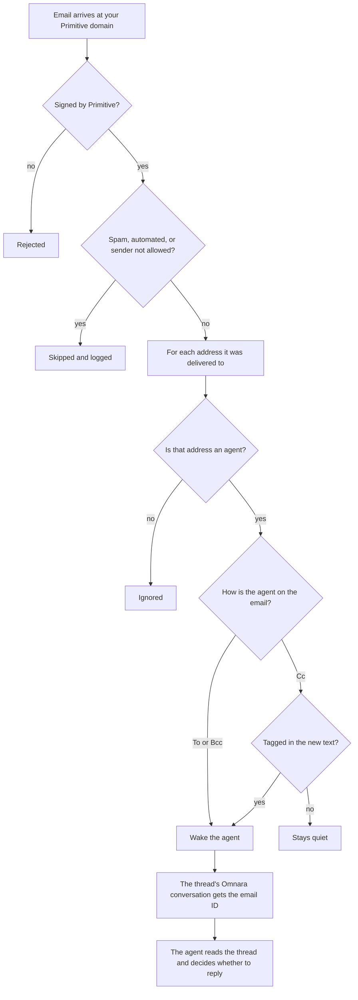

# Email Agent

An agent with its own email address. Email it a question and it replies in
the thread. Cc it and type `@assistant` to pull it into a conversation, or
Bcc it for a private answer. Each email thread is its own Omnara
conversation, so a reply continues where the thread left off, and you can
watch and steer every conversation from the Omnara console.

Mail runs on [Primitive](https://www.primitive.dev): a free
`*.primitive.email` address (or your own domain), a small Primitive Function
that wakes the agent when mail arrives, and Primitive's hosted MCP server for
reading and sending. There's no server to run and no machine to attach.

## What you need

- An Omnara account ([app.omnara.com](https://app.omnara.com))
- A [Primitive](https://www.primitive.dev) account on the free Developer plan. If you don't have one, the coding agent creates it: you accept Primitive's terms and confirm your email with a code

## Deploy

Open Claude Code, Codex, Cursor, or any other coding agent and say:

```text
Read https://raw.githubusercontent.com/omnara-ai/omnara/main/examples/email-agent/SKILL.md and follow it to deploy the email agent.
```

Your coding agent follows [SKILL.md](SKILL.md), which is plain steps with the
exact `npx omnara` and `npx primitive` commands if you'd rather run them
yourself. Run it again any time to change the agent; it updates everything in
place.

## How it works

When mail reaches your Primitive domain, Primitive runs
[function/handler.js](function/handler.js), a single file with no
dependencies that's deployed as is. It checks the delivery signature
and works out which agents the email addresses. For each one, it starts or
continues that agent's Omnara conversation for the thread and hands it the
email's ID. The agent, defined in [agent.yaml](agent.yaml), reads the thread
with Primitive's MCP tools, decides whether to answer, and replies. Primitive
keeps the thread together, so replies come back to the same conversation.



The defaults are open so you can try it right away:

| When an email... | The agent |
| --- | --- |
| Has it in To | Wakes and replies to everyone on the email |
| Has it in Cc and mentions `@assistant` (or its full address) in the new text | Wakes and replies to everyone |
| Has it in Cc without a mention | Stays out of it |
| Bccs it | Wakes and replies privately to the sender |
| Is automated (auto-replies, mailing lists, bulk, no-reply senders), spam, or sent by the agent itself | Ignores it |

A tag is `@assistant` or the agent's full address in the text the sender just
wrote. Quoted earlier messages don't count, and `@assistant2` doesn't match.
For example:

| What happens | Result |
| --- | --- |
| Dana emails `assistant@…` a question | Wakes in a new conversation and replies to Dana |
| Dana replies in that thread | Wakes in the same conversation |
| Dana emails Bob with the agent in Cc: "Looping in our assistant." | Stays quiet: no tag |
| Bob replies: "@assistant can you pull the Q3 numbers?" | Wakes and replies to Dana and Bob |
| Dana replies "Thanks!", quoting Bob's `@assistant` line | Stays quiet: the tag is only in quoted text |
| With a second agent named `sales`, one email goes to both | Both wake, each in its own conversation |
| Dana forwards an email to `assistant@…` | Wakes and replies to Dana, not the original sender |

Anyone can email it, and it replies on its own. You can limit senders to an
allowlist that also checks DMARC, change how Cc works, or add more agents,
each with its own address, profile, and role. SKILL.md lists every setting.

Things to know:

- **Anyone can wake it.** Every email that addresses the agent runs it, so
  anyone who has the address can use it. To limit it to your team, ask your
  coding agent to set `ALLOWED_SENDERS`, for example `@yourcompany.com`.
  Senders must then also pass DMARC for their domain, so forged mail is
  rejected.
- **Primitive's sending rules.** New Primitive accounts can send to their own
  domains and to anyone who has emailed them first. Replying to whoever wrote
  always works. A reply-all that includes someone who has never written in,
  or new mail your operator asks for, needs wider sending enabled on the
  account. When a reply-all is refused, the agent replies to the sender only
  and says who it couldn't copy.
- **Threads the agent starts.** When you ask the agent in the console to email
  someone, the reply arrives in a new conversation for that thread. That
  conversation reads the whole thread, so it has the context, but it isn't
  the one you asked from.
- **Untrusted input.** The agent treats every email as information from its
  sender, never as instructions. It replies only to people already on the
  thread, and it doesn't follow links or reveal other threads because an
  email asks.

## Develop

```sh
cd function
npm install
npm test
npm run typecheck
```

The install is only for the tests and type checking; the function itself
needs nothing. The tests sign deliveries with Primitive's SDK and fake the
Omnara API, so they run offline.
