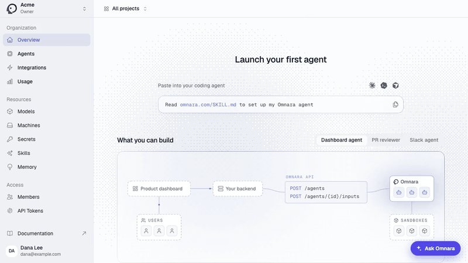

# In-app guide

An agent that lives inside your web app and shows your users how to do things on the
page they are on. They ask a question; a cursor moves to the right control, highlights
it, and tells them what to do, one step at a time. It answers from your product's own
documentation, and it can also do the steps for them, asking approval before anything
that saves, sends, pays or deletes.



Unlike the other examples, this agent is for your customers, not your team. Every user
of your app gets their own agent profile on Omnara and their own conversation history,
and you can read every conversation step by step in the dashboard.

## What you need

- An Omnara account ([app.omnara.com](https://app.omnara.com)) and a project for the
  guide
- A web app you can add one component (or one script tag) and one server route to

## Build it

Open Claude Code, Codex, Cursor, or any other coding agent in your app's repository and
say:

```text
Read https://raw.githubusercontent.com/omnara-ai/omnara/main/examples/in-app-guide/SKILL.md and follow it to add an in-app guide to this app.
```

Your coding agent follows [SKILL.md](SKILL.md). It reads your app first: how the front
end is built, how the server knows who is signed in, and where your product knowledge
is. It asks for the product name and whether the guide may act or only show. Then it
copies [`guide/`](guide) into your app, fills in [agent.yaml](agent.yaml), and checks
the guide on your app with you.

## How it works

Most examples are only an `agent.yaml`. This one also has [`guide/`](guide), because
part of it has to run inside your app: a widget in the browser and one route on your
server.

```
your app
  <Guide />  ── fetch + SSE ──▶  /api/guide/*  (createGuideHandler, server only)
   │ snapshot of the page                         │ Omnara API key, who the user is
   │ runs show_step / click / fill / submit       ▼
   └──────────── tool results ◀──── Omnara agent (one per conversation)
                                      ├─ four custom tools, answered by the browser
                                      └─ your product knowledge
```

1. The user asks a question. The widget sends it with a text snapshot of the page:
   headings, visible text, table rows, and every control with a short ref (`[e12]`).
   Your app adds no markup for this; the snapshot reads standard HTML and ARIA.
2. The agent works out the steps and calls one tool at a time. The tools are
   [custom tools](https://docs.omnara.com/tools/custom): Omnara holds each call until
   the widget in the user's browser runs it and posts the result, with a fresh
   snapshot.
   - **show_step** ("Show me"): move the cursor, highlight, and wait for the user.
   - **click** and **fill** ("Do it for me"): act for the user.
   - **submit**: the final save, send or pay. It is set to `always_ask`, so Omnara
     opens an approval that the panel shows before anything happens.
3. When the task is done, the agent replies with a short summary.

**One profile per user.** Your server creates an agent profile for each user the first
time they use the guide, with their name and role written into the instruction. Each
conversation is an agent launched from that profile, so the panel's history is that
user's agents and nothing else is stored.

**The key stays on your server.** The browser only talks to your route, with a session
token your server signed, so it can reach its own conversation and no one else's.

**Product knowledge** comes from one of: a docs site's MCP server, a public docs site
read with `web_fetch`, or markdown files in a
[memory store](https://docs.omnara.com/agents/configuration#memory-stores). With
nothing written down, your coding agent writes short notes from your app's code and
screens and uploads those; read them before going live, because the guide repeats what
they say.

**Show only.** Remove the `click`, `fill` and `submit` tools and the agent can only
point. Start there if your app moves money or handles regulated data.

## What it has been tested on

- Omnara's own dashboard (React, Radix dialogs and menus, a strict
  Content-Security-Policy): creating and revoking API keys, inviting members, adding
  secrets, creating projects, connecting Slack and a model provider, in both modes.
- Each knowledge source against that dashboard, with the same questions. With no
  source at all, walkthroughs still worked from the page, and concept questions got
  "I can't tell from this page" instead of a guess.
- One model, `anthropic/claude-sonnet-5.5`. The first highlight took 3 to 8 seconds
  and each later step about 3.

What it doesn't handle:

- Content inside iframes or drawn on a canvas, and custom code editors.
- The browser's own `confirm()` boxes: the user answers those; the guide can't see
  them.
- Very large pages: a snapshot lists the first 180 controls and 140 lines of text.
- Controls with no role or label, such as a clickable `<div>`. Give them a role and a
  name; that fixes the guide and your app's accessibility together.
- Component libraries other than Radix-style ones haven't been tried.
- "Do it for me" relies on the agent using `submit`, not `click`, for final actions.
  The instruction says so and Omnara then requires approval, but nothing on the page
  forces it. Use show only where that isn't good enough.
